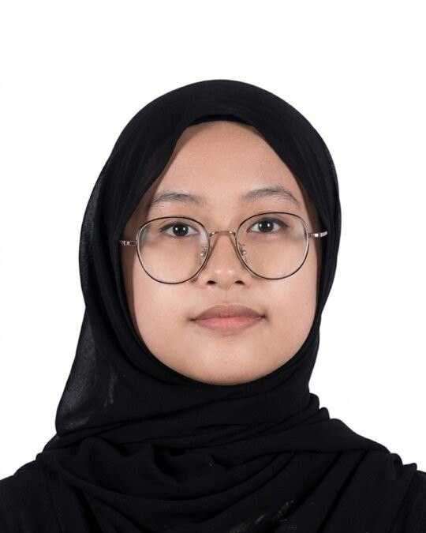

  <!-- Replace avatar.jpg with your uploaded image filename -->
  
  
  <h1>Hi there, I'm Siti ! 👋</h1>
  
<em> Student of UTM studying Bachelor of Computer Science (Data Engineering) </em>

  

    
    
  

---

### 🚀 About Me
- 👯 I’m looking to collaborate on **Plantation and Irrigation industry**
- 💬 Ask me about **basis of coding of C++**
- ⚡ Fun fact: **Eager to learn new things and be the youngest in the room**

---

### 🛠 Tech Stack
**Languages:**  
`C++` 

**Tools & Databases:**  
`Git` `GitHub`

---

### 📊 GitHub Stats

  
  

